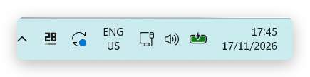
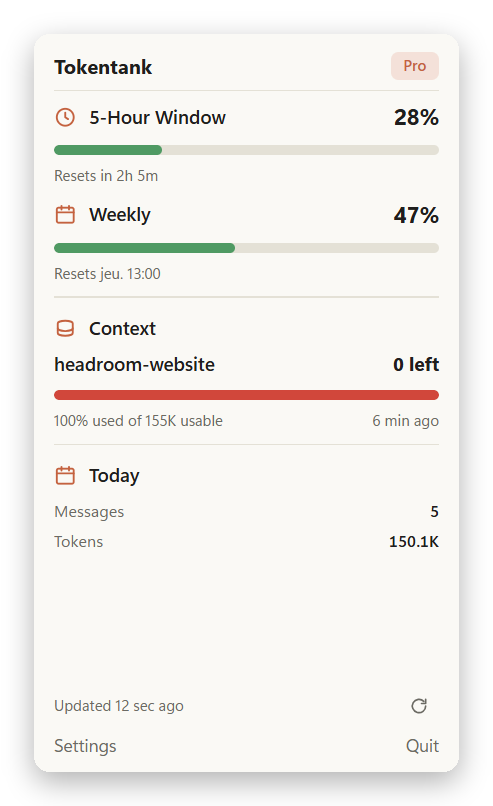
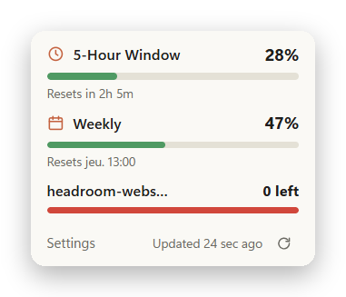

<h1 align="center">Tokentank</h1>

  Your Claude Code limits, always visible in the Windows system tray.

  <a href="https://github.com/somoncef/Tokentank-Releases/releases/latest/download/Tokentank-Setup.exe"><b>Download for Windows</b></a>
  ·
  <a href="https://headroom-two-dusky.vercel.app">Website</a>
  ·
  <a href="https://headroom-two-dusky.vercel.app/pricing/">Pricing</a>

  

---

## What it does

Claude Code has a 5-hour window and a weekly limit, and there is no way to see
where you stand without typing `/usage` and breaking your flow. Tokentank puts
the number in your taskbar and keeps it there.

The tray icon is the percentage itself, not a logo. One glance tells you whether
to start a heavy session or save it for after the reset.

  

| | |
|---|---|
| **5-hour window** | Percentage used and a countdown to the next reset |
| **Weekly limit** | The same, for the weekly cap |
| **Context** | How much room is left in your current session before it compacts, with the project name |
| **Today** | Messages sent and tokens used since midnight |
| **Alerts** | A Windows notification at 50, 75 and 90 percent, and when context runs low. Each fires once |

### Compact view

If you only want the limits, switch to the compact popup in Settings. Switch
back whenever you like.

  

---

## Installing

1. **[Download Tokentank-Setup.exe](https://github.com/somoncef/Tokentank-Releases/releases/latest/download/Tokentank-Setup.exe)** and run it. It installs for your user account only, so it never asks for admin rights.

2. **Windows will warn you the first time.** You will see a blue *Windows protected your PC* screen. Click **More info**, then **Run anyway**. This happens to every new installer until it builds up a reputation with Microsoft, signed or not.

3. **Make sure Claude Code is signed in.** If you have never run it, open a terminal and run `claude` once. Tokentank finds the sign-in on its own — there is no second login and nothing to paste.

4. **Drag the icon out of the overflow.** New tray icons start hidden behind the `^` arrow next to the clock. Drag it onto the taskbar so the percentage is always in view.

Turn on **Start with Windows** in Settings and you can forget it is there until it matters.

---

## Requirements

- Windows 10 or 11, 64-bit
- Claude Code installed and signed in on the same PC
- A Claude Pro or Max plan — the plans that have 5-hour and weekly limits

---

## Privacy

Tokentank runs entirely on your machine. It reads the Claude Code sign-in that
is already on your PC and asks Anthropic for your own usage figures, and it
reads your local Claude Code session files to estimate context. Those requests
go from your computer to Anthropic directly.

There is no account, no telemetry, no analytics and no crash reporting. Your
sign-in token is never copied or sent anywhere. Nobody can see your usage,
your projects or your prompts.

Full policy: [tokentank.vercel.app/privacy](https://headroom-two-dusky.vercel.app/privacy/)

---

## Updates

Every release is published here. The download link above always points at the
newest version, so you can use it again to update — install over the top and
your settings are kept.

---

## Support

Something not working? Email **somoncef@example.com** with your Windows version
and what you are seeing.

There is a 14-day money-back guarantee, no questions asked:
[refund policy](https://headroom-two-dusky.vercel.app/refunds/).

---

## About this repository

This repository exists to host the Windows installers. The source code is not
public.

Tokentank is an independent product. It is not affiliated with, endorsed by or
supported by Anthropic. Claude and Claude Code are trademarks of Anthropic.
It relies on a usage endpoint that Anthropic does not publicly document, so if
that changes, an update will follow.
